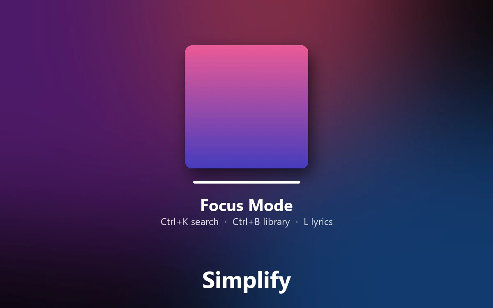
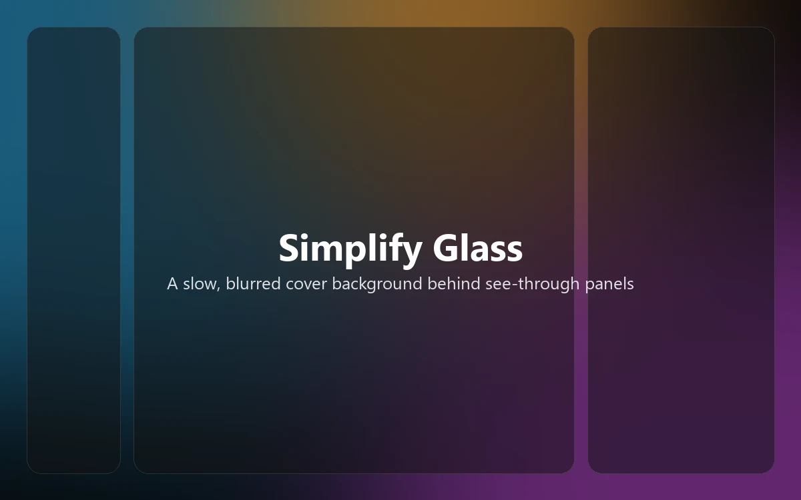

# Simplify

A calm way to use Spotify. Simplify opens Spotify straight into **Focus Mode**: the
album cover on its own over a moving cover-coloured background, with nothing else on
screen. Everything else is one shortcut away and slides in only while you use it.



Simplify is a modified version of **[Spicy Lyrics](https://github.com/Spikerko/spicy-lyrics)**
by [Spikerko](https://github.com/Spikerko), so it keeps Spicy Lyrics' word-by-word
lyrics, animations and backgrounds. If you like the lyrics, the credit is theirs;
[support the original author](https://ko-fi.com/spikerko).

## Shortcuts

| Key | What it does |
|---|---|
| **Ctrl+K** | Search songs, albums, playlists and artists. Pick one to play it right away. |
| **Ctrl+B** | Your library as a slim column of covers. Click one to play it. |
| **L** | Show or hide the lyrics. |
| **Esc** | Close search or the library. |
| **Ctrl+Shift+F** | Switch between Focus Mode and normal Spotify. |

Play, pause, skip, like and volume are the controls that appear when you move the
mouse over the cover. Focus Mode can be turned off in Simplify's settings
(Settings → Experiments → Focus Mode).

## Extras (optional, separate installs)

- **Simplify Glass**: a slow, blurred copy of the cover behind the whole app, with
  see-through panels. It redraws 20 times a second at most and stops while Spotify
  is minimized or covered.
- **Simplify Polish**: accent colour taken from the cover, rounder panels and cards,
  smoother hovers, and no podcast rows on Home.



## Install

Simplify runs in the Spotify **desktop** app through [Spicetify](https://spicetify.app)
and doesn't need Premium.

1. Install Spicetify and its Marketplace ([guide](https://spicetify.app/docs/getting-started)).
2. In Spotify, open **Marketplace**, search for **Simplify** and install it.
   Install **Simplify Glass** and **Simplify Polish** too if you want them.
3. **Don't keep Spicy Lyrics installed at the same time.** The two use the same page
   and settings; if both are there, Simplify switches itself off and tells you.

### Optional: never see normal Spotify at startup (Windows)

Extensions load a moment after Spotify draws its home screen, so normal Spotify
flashes briefly before Focus Mode slides in. A small style file can cover that moment
with a dark screen that fades into Focus Mode. Download
[`scripts/focus-cover.css`](./scripts/focus-cover.css) and
[`scripts/install-focus-cover.ps1`](./scripts/install-focus-cover.ps1) into one folder
and run, in PowerShell from that folder:

```powershell
powershell -ExecutionPolicy Bypass -File .\install-focus-cover.ps1
```

Run it again with `-Remove` to take it out. If Simplify ever fails to start, the cover
fades away on its own after 12 seconds.

## Lyrics sources and privacy

- Lyrics come from the **Spicy Lyrics lyrics service**, the same one the original
  extension uses. Requests carry a `Simplify-Client` header so the service can tell
  Simplify apart from the original.
- If that service has nothing for a song or can't be reached, Simplify asks
  **[LRCLIB](https://lrclib.net)**, a free public lyrics database. Only the song's
  title, artist, album and length are sent. LRCLIB lyrics are timed per line, not per
  word.
- Simplify doesn't check for updates or download settings from the original's
  servers; Marketplace keeps it up to date.

## Problems

[Open an issue](https://github.com/glicheee/simplify/issues). Settings → Bug report
copies a report you can paste in (no account details or tokens are included).
Please don't send Simplify problems to the Spicy Lyrics Discord.

## License

AGPL-3.0, the same as Spicy Lyrics. See [LICENSE](./LICENSE) and
[NOTICE.md](./NOTICE.md) for what Simplify changes.
